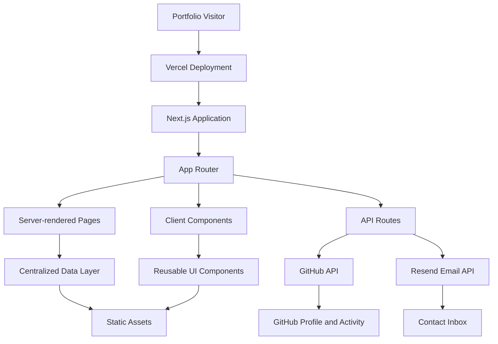
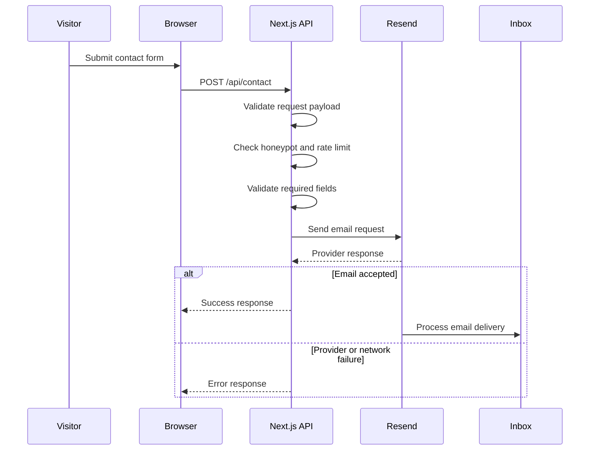
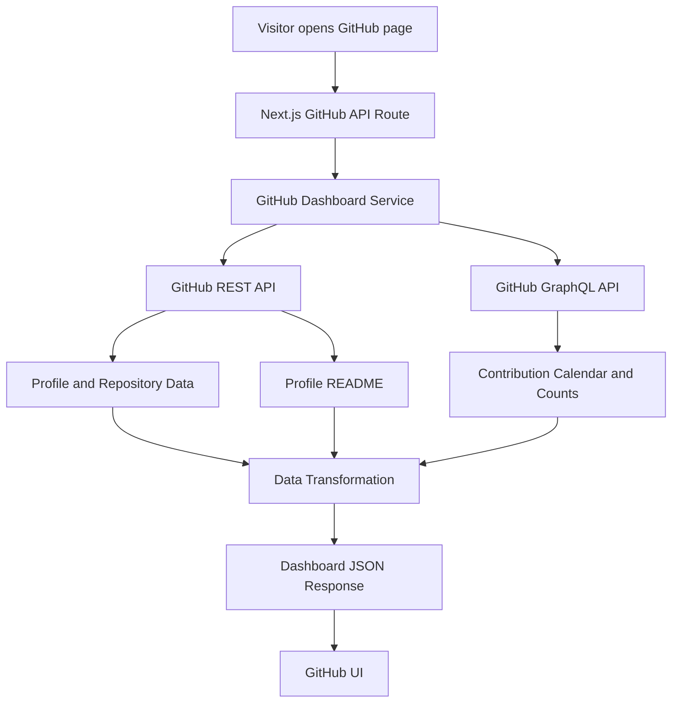
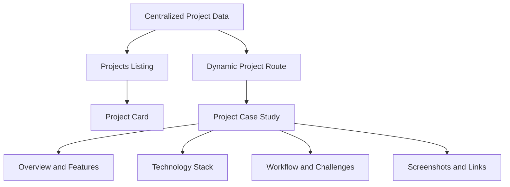

# Aryan Agarwal — Full-Stack Developer Portfolio

<p align="center">
  <a href="https://my-portfolio-bhumatrix.vercel.app">
    <strong>🌐 Live Portfolio</strong>
  </a>
  &nbsp;·&nbsp;
  <a href="https://github.com/aryan24cse109-dev/My-Portfolio">
    <strong>GitHub Repository</strong>
  </a>
  &nbsp;·&nbsp;
  <a href="https://www.linkedin.com/in/aryan-agarwal-7829b4297/">
    <strong>LinkedIn</strong>
  </a>
</p>

A production-deployed developer portfolio built to present software projects, engineering experience, technical skills, open-source contributions, and professional contact information.

The application follows a component-driven architecture using **Next.js App Router, React, TypeScript, and Tailwind CSS 4**. It combines server-rendered pages with client-side interactions, API routes, external service integrations, and a centralized data layer.

---

## Table of Contents

- [Overview](#overview)
- [Architecture](#architecture)
- [Technology Stack](#technology-stack)
- [Application Structure](#application-structure)
- [Core Features](#core-features)
- [Application Routes](#application-routes)
- [System Workflows](#system-workflows)
- [API Architecture](#api-architecture)
- [External Integrations](#external-integrations)
- [UI and Motion Architecture](#ui-and-motion-architecture)
- [SEO and Metadata](#seo-and-metadata)
- [Security and Reliability](#security-and-reliability)
- [Environment Configuration](#environment-configuration)
- [Local Development](#local-development)
- [Build and Validation](#build-and-validation)
- [Deployment](#deployment)
- [Documentation](#documentation)
- [Future Improvements](#future-improvements)

---

## Overview

The portfolio is designed as a developer-focused presentation layer rather than a static landing page.

It provides a structured view of:

- Professional introduction and technical profile.
- Skills grouped by engineering domain.
- Full-stack and software development projects.
- Project architecture, implementation workflows, and technical challenges.
- Technical experience, training, and hackathon participation.
- GitHub profile information and contribution activity.
- Resume viewing and downloading.
- A server-validated contact form with email delivery.

The application uses a dark editorial design system, responsive layouts, reusable UI components, optimized project imagery, and motion-based interactions.

**Production URL:**  
https://my-portfolio-bhumatrix.vercel.app

---

## Architecture

The project follows a **Next.js full-stack application architecture**.

Instead of maintaining a separate frontend and backend deployment, the application uses Next.js for both the presentation layer and server-side API endpoints.

### High-Level Architecture



### Architectural Layers

| Layer | Responsibility |
|---|---|
| Presentation | Page layouts, responsive UI, navigation, and visual components |
| Routing | File-system-based routing through the Next.js App Router |
| Client interaction | Form state, navigation interactions, animations, and dynamic UI |
| Server/API | Contact form processing and GitHub dashboard data |
| Data | Centralized project, experience, skills, and site configuration |
| Integrations | GitHub REST/GraphQL APIs and Resend |
| Deployment | Production hosting and server environment configuration through Vercel |

### Rendering Strategy

The application uses a combination of server and client components.

- **Server Components:** Used by default for route-level rendering and server-side functionality.
- **Client Components:** Used where browser-side interaction, state, animation, or event handling is required.
- **Route Handlers:** Handle server-side API requests without exposing private credentials to the browser.
- **Static Assets:** Images, icons, project screenshots, and resume files are served from the public directory.

This separation keeps API credentials on the server while allowing interactive user experiences in the browser.

---

## Technology Stack

### Frontend

| Technology | Purpose |
|---|---|
| Next.js 15 | Full-stack React framework and App Router |
| React 19 | Component-based UI development |
| TypeScript | Static typing and maintainable application code |
| Tailwind CSS 4 | Utility-first styling |
| Custom CSS | Design tokens, responsive layouts, and visual effects |
| Motion for React | Declarative UI animations and transitions |
| Lucide React | Icon system |
| Next Image | Image optimization and responsive image rendering |

### Backend and Server Runtime

| Technology | Purpose |
|---|---|
| Next.js Route Handlers | Server-side API endpoints |
| Node.js | Server runtime |
| Fetch API | External API communication |
| Resend | Transactional email delivery |
| GitHub REST API | Public profile and repository information |
| GitHub GraphQL API | Contribution calendar and contribution statistics |

### Infrastructure and Tooling

| Technology | Purpose |
|---|---|
| Vercel | Production hosting and deployment |
| npm | Dependency management |
| ESLint | Code quality and linting |
| TypeScript Compiler | Static type checking |
| Git and GitHub | Version control and source management |

---

## Application Structure

```text
My-Portfolio/
│
├── README.md
│
├── docs/
│   ├── ASSET_MAP.md
│   ├── CONTENT_GUIDE.md
│   ├── DESIGN_SYSTEM.md
│   └── DEPLOYMENT.md
│
└── frontend/
    │
    ├── public/
    │   ├── brand/
    │   ├── icons/
    │   ├── images/
    │   │   ├── og/
    │   │   ├── profile/
    │   │   └── projects/
    │   └── resume/
    │       └── Aryan-Agarwal-CV.pdf
    │
    ├── src/
    │   │
    │   ├── app/
    │   │   ├── api/
    │   │   │   ├── contact/
    │   │   │   │   └── route.ts
    │   │   │   └── github/
    │   │   │       └── route.ts
    │   │   │
    │   │   ├── projects/
    │   │   │   └── [slug]/
    │   │   │
    │   │   ├── about/
    │   │   ├── skills/
    │   │   ├── experience/
    │   │   ├── github/
    │   │   ├── contact/
    │   │   │
    │   │   ├── layout.tsx
    │   │   ├── page.tsx
    │   │   ├── sitemap.ts
    │   │   ├── robots.ts
    │   │   └── globals.css
    │   │
    │   ├── components/
    │   │   ├── site-shell.tsx
    │   │   ├── site-header.tsx
    │   │   ├── site-footer.tsx
    │   │   ├── home-intro.tsx
    │   │   └── ...
    │   │
    │   ├── data/
    │   │   ├── site.ts
    │   │   ├── projects.ts
    │   │   └── experience.ts
    │   │
    │   └── lib/
    │       └── github.ts
    │
    ├── .env.example
    ├── package.json
    ├── next.config.ts
    ├── postcss.config.mjs
    └── tsconfig.json
```

*The tree highlights the main architectural areas; some component and configuration files are omitted for brevity.*

### Important Directories

**`src/app/`**

Contains application routes, layouts, global styles, metadata, and server-side route handlers.

**`src/components/`**

Contains reusable UI components such as the site header, footer, navigation, page sections, and motion-related components.

**`src/data/`**

Provides a centralized content layer. Project details, profile configuration, skills, social links, and experience records are maintained independently of the page components.

**`src/lib/`**

Contains reusable server-side logic, including GitHub API integration, data transformation, and caching.

**`public/`**

Stores static assets such as project screenshots, profile images, brand assets, icons, and the downloadable resume.

---

## Core Features

### 1. Developer Landing Page

The homepage introduces the developer through a structured hero section and provides navigation to the main portfolio sections.

Implementation highlights:

- Responsive hero layout.
- Motion-based entrance animations.
- Reusable navigation and page components.
- Project and experience previews.
- Direct navigation to detailed sections.

### 2. Skills Showcase

Technical skills are organized into categories:

- Programming Languages
- Frontend Development
- Backend Development
- Databases and Data
- API and AI Integrations
- Development Tools

Skill information is maintained in the centralized `src/data/site.ts` file.

### 3. Project Case Studies

Project content is driven by structured records in `src/data/projects.ts`.

Each project can contain:

- Project overview and problem statement.
- Technical solution.
- Technology stack.
- Development workflow.
- Implemented features.
- Engineering challenges.
- Technical limitations.
- Screenshots and visual galleries.
- Repository and live deployment links.

Dynamic project detail pages use the project slug:

```text
/projects/[slug]
```

This avoids maintaining a separate hardcoded page for every project.

### 4. Experience and Hackathons

The experience section is powered by `src/data/experience.ts`.

It presents technical training, hackathon participation, team responsibilities, project involvement, and recorded outcomes.

### 5. GitHub Activity Dashboard

The GitHub section integrates with GitHub's REST and GraphQL APIs.

It can display:

- Public GitHub profile information.
- Public repositories.
- Profile README content.
- Contribution calendar.
- Pull request contribution count.
- Issue contribution count.
- Pull request review contribution count.
- Selected open-source pull request statuses.

The dashboard is designed to preserve available public information even when authenticated contribution data cannot be loaded.

### 6. Resume Integration

The resume is served as a static PDF asset.

```text
frontend/public/resume/Aryan-Agarwal-CV.pdf
```

The configured path and filename are maintained in `src/data/site.ts`.

The portfolio provides:

- View Resume.
- Download CV.

The resume actions are rendered when the expected PDF file is available in the application build.

### 7. Contact Form

The contact form provides a server-side email submission workflow using Resend.

It includes:

- Name, email, subject, and message validation.
- Email format validation.
- Message length restrictions.
- Hidden honeypot field.
- Basic IP-based rate limiting.
- Server-side email delivery.
- Reply-to support using the visitor's submitted email address.
- Error handling for unavailable or failed delivery.

The API never sends the Resend API key to the client.

---

## Application Routes

| Route | Description |
|---|---|
| `/` | Homepage and developer introduction |
| `/about` | Developer profile and background |
| `/skills` | Technical skills and technologies |
| `/projects` | Project listing |
| `/projects/[slug]` | Individual project case study |
| `/experience` | Experience and hackathon timeline |
| `/github` | GitHub profile and activity dashboard |
| `/contact` | Contact information and email form |
| `/sitemap.xml` | Generated sitemap |
| `/robots.txt` | Search engine crawling rules |

The application also includes a custom not-found route.

---

## System Workflows

### 1. Contact Form Submission Flow



The server uses these environment variables:

- `RESEND_API_KEY`
- `CONTACT_EMAIL`
- `RESEND_FROM_EMAIL`

The sender address must be permitted by the Resend account. The current testing configuration can use Resend's onboarding sender when sending to the account's authorized test recipient.

A successful API response means Resend accepted the request; it does not independently confirm final inbox delivery.

### 2. GitHub Dashboard Flow



The public profile and repository information can load without an authenticated token.

The contribution calendar and contribution-category counts require a server-side `GITHUB_TOKEN`.

### 3. Project Content Flow



Project content is maintained separately from UI components, making it easier to update project details without changing the rendering architecture.

---

## API Architecture

The application currently exposes two primary server-side API routes.

### `GET /api/github`

**Purpose:** Retrieve GitHub dashboard information.

Responsibilities:

- Read requested contribution year.
- Retrieve public GitHub profile information.
- Retrieve public repositories.
- Retrieve profile README content.
- Fetch authenticated contribution data when a token is configured.
- Optionally retrieve selected pull request statuses.
- Return normalized dashboard data.

Optional query parameters:

```text
/api/github?year=2026
/api/github?year=2026&includePullRequests=true
```

Implementation:

```text
src/app/api/github/route.ts
src/lib/github.ts
```

### `POST /api/contact`

**Purpose:** Process portfolio contact submissions.

Responsibilities:

- Parse incoming JSON.
- Reject oversized requests.
- Validate form fields.
- Detect automated submissions through a honeypot.
- Apply basic request rate limiting.
- Send email through Resend.
- Return success or failure responses.

Implementation:

```text
src/app/api/contact/route.ts
```

---

## External Integrations

### GitHub REST API

Used for:

- Public profile information.
- Public repository metadata.
- Profile README retrieval.
- Selected pull request status lookups.

### GitHub GraphQL API

Used for:

- Contribution calendar.
- Total contributions.
- Pull request contribution count.
- Issue contribution count.
- Pull request review contribution count.

Authenticated requests use the server-side `GITHUB_TOKEN`.

### Resend

Used for contact form email delivery.

The server sends email requests to Resend with:

- Configured sender address.
- Destination inbox.
- Visitor email as `reply_to`.
- Portfolio contact subject.
- Submitted message content.

No email provider credentials are exposed through public frontend environment variables.

---

## UI and Motion Architecture

The visual system uses a dark editorial design language.

### Design Principles

- Dark background surfaces.
- Restrained blue and violet accents.
- Clear typography hierarchy.
- Generous spacing and negative space.
- Low-opacity dividers.
- Screenshot-forward project presentation.
- Responsive layouts across desktop and mobile.

### Typography

- Inter for body and interface text.
- Space Grotesk for display headings.

### Motion

Motion for React is used for controlled interface transitions and entrance effects.

Examples include:

- Hero content reveal.
- Staggered text and element animations.
- Route and section transitions.
- Scroll-related visual effects.
- Interactive hover and focus feedback.

CSS handles routine hover and focus transitions.

Reduced-motion preferences are respected so users who request reduced motion are not forced to experience unnecessary movement.

### Accessibility

The interface incorporates:

- Semantic HTML landmarks.
- Skip-to-content navigation.
- Visible keyboard focus indicators.
- Descriptive image alternative text.
- Responsive navigation behavior.
- Escape-to-close mobile navigation.
- Reduced-motion support.
- Touch-friendly interactive elements.

---

## SEO and Metadata

The application uses Next.js Metadata APIs and generated metadata routes.

Implemented capabilities include:

- Page titles and descriptions.
- Canonical URLs.
- Open Graph metadata.
- Twitter card metadata.
- Favicon and application icons.
- Person and WebSite structured data.
- Dynamic sitemap generation.
- Robots configuration.

The production origin is controlled by:

```env
NEXT_PUBLIC_SITE_URL=https://my-portfolio-bhumatrix.vercel.app
```

This ensures absolute production URLs are generated from the deployed origin rather than a local development address.

---

## Security and Reliability

Security is handled primarily at the server boundary.

### Contact Form Protection

- Server-side input validation.
- Request body size restriction.
- Email format validation.
- Hidden honeypot field.
- Basic IP-based request throttling.
- Server-only Resend credentials.
- No success response when the email provider rejects the request.

### GitHub Token Protection

- `GITHUB_TOKEN` is accessed only on the server.
- It is never exposed through a `NEXT_PUBLIC_` variable.
- Public profile and repository data remain available without the token.
- API failures are represented through explicit unavailable states.

### Caching

GitHub data uses Next.js data caching with a one-hour revalidation policy.

The dashboard service also maintains an in-process cache controlled by:

```env
GITHUB_CACHE_SECONDS=3600
```

The cache has a minimum configured duration of 60 seconds.

### Known Operational Limitations

- Contact form rate limiting uses an in-memory `Map`, so it is not shared across serverless instances and resets when the process restarts.
- GitHub contribution statistics depend on a valid token and GitHub API availability.
- Resend acceptance does not guarantee final inbox delivery; delivery events must be checked through Resend.
- The portfolio does not use a dedicated application database because its content is maintained in structured source files and its live data comes from external APIs.

---

## Environment Configuration

Create a local environment file:

```bash
cp .env.example .env.local
```

Configure the following variables inside `frontend/.env.local`.

| Variable | Required | Description |
|---|---|---|
| `NEXT_PUBLIC_SITE_URL` | Recommended | Public production origin |
| `GITHUB_TOKEN` | Optional | GitHub GraphQL contribution access |
| `GITHUB_CACHE_SECONDS` | Optional | GitHub dashboard cache duration |
| `RESEND_API_KEY` | For email | Resend API authentication |
| `CONTACT_EMAIL` | For email | Destination inbox |
| `RESEND_FROM_EMAIL` | For email | Authorized sender identity |

Example:

```env
NEXT_PUBLIC_SITE_URL=http://localhost:3000

GITHUB_TOKEN=
GITHUB_CACHE_SECONDS=3600

RESEND_API_KEY=
CONTACT_EMAIL=
RESEND_FROM_EMAIL=
```

**Important:**

- Never commit `.env.local`.
- Never expose API keys using `NEXT_PUBLIC_` variables.
- Use a valid Resend sender identity.
- Configure production environment variables in Vercel separately from local environment files.
- Redeploy after changing production environment variables.

---

## Local Development

### Prerequisites

- Node.js 20 or later.
- npm.
- Git.

### 1. Clone the Repository

```bash
git clone https://github.com/aryan24cse109-dev/My-Portfolio.git
```

### 2. Navigate to the Frontend

```bash
cd My-Portfolio/frontend
```

### 3. Install Dependencies

```bash
npm install
```

### 4. Configure Environment Variables

Create `.env.local` using `.env.example` as a reference.

Add only the credentials required for the integrations you want to test.

### 5. Start the Development Server

```bash
npm run dev
```

Open:

```text
http://localhost:3000
```

---

## Build and Validation

The project includes the following validation scripts:

### TypeScript Validation

```bash
npm run typecheck
```

Runs TypeScript without emitting compiled files.

### ESLint

```bash
npm run lint
```

Checks source files for linting and code-quality issues.

### Production Build

```bash
npm run build
```

Creates the optimized Next.js production build.

### Production Preview

```bash
npm run start
```

Starts the production server after a successful build.

---

## Deployment

The portfolio is deployed on **Vercel**.

**Live Application:**  
https://my-portfolio-bhumatrix.vercel.app

### Deployment Configuration

The application is located inside the `frontend/` directory.

When configuring the Vercel project:

| Setting | Value |
|---|---|
| Framework Preset | Next.js |
| Root Directory | `frontend` |
| Install Command | `npm install` |
| Build Command | `npm run build` |
| Output Directory | Next.js default |

### Production Environment Variables

Configure the required variables through:

```text
Vercel Dashboard
    → Project
    → Settings
    → Environment Variables
```

Add the relevant variables for the Production environment.

After configuration changes, trigger a new deployment.

### Post-deployment Verification

- Verify all application routes.
- Test responsive layouts.
- Verify resume viewing and downloading.
- Test contact form submission.
- Check Resend delivery events.
- Verify GitHub profile and contribution data.
- Check canonical metadata, sitemap, and robots output.
- Inspect browser console and server logs.

---

## Documentation

Additional engineering documentation is maintained in the `docs/` directory.

| Document | Description |
|---|---|
| [ASSET_MAP.md](docs/ASSET_MAP.md) | Brand assets, project screenshots, and image references |
| [CONTENT_GUIDE.md](docs/CONTENT_GUIDE.md) | Updating project, profile, and experience content |
| [DESIGN_SYSTEM.md](docs/DESIGN_SYSTEM.md) | Colors, typography, spacing, motion, and accessibility |
| [DEPLOYMENT.md](docs/DEPLOYMENT.md) | Environment setup, integrations, and deployment instructions |

---

## Future Improvements

Potential engineering improvements include:

- Shared rate limiting through a distributed store.
- More detailed email delivery observability.
- Automated integration tests for API routes.
- End-to-end tests for important user workflows.
- Improved GitHub API resilience and monitoring.
- Performance monitoring and real-user metrics.
- Automated accessibility checks in CI.
- Continuous integration for type checking, linting, and production builds.

---

## Author

**Aryan Agarwal**  
Full-Stack Developer

- Portfolio: https://my-portfolio-bhumatrix.vercel.app
- GitHub: https://github.com/aryan24cse109-dev
- LinkedIn: https://www.linkedin.com/in/aryan-agarwal-7829b4297/
- YouTube: https://www.youtube.com/@AryanAgarwal-t6e

---

<p align="center">
  <strong>Designed and engineered with a focus on useful software, clean architecture, and practical engineering.</strong>
</p>
