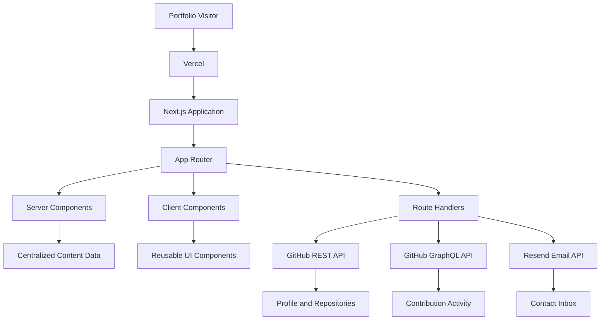
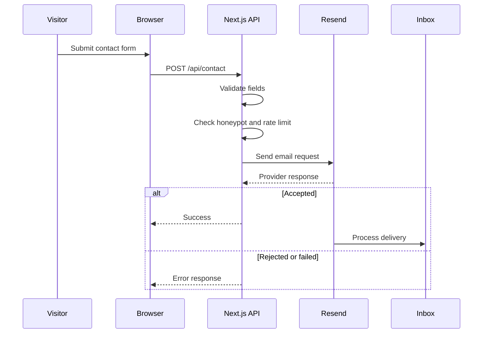

# Aryan Agarwal — Developer Portfolio

<p align="center">
  <a href="https://my-portfolio-bhumatrix.vercel.app"><strong>Live Portfolio ↗</strong></a>
  &nbsp;·&nbsp;
  <a href="https://github.com/aryan24cse109-dev/My-Portfolio"><strong>Source Code</strong></a>
  &nbsp;·&nbsp;
  <a href="https://www.linkedin.com/in/aryan-agarwal-7829b4297/"><strong>LinkedIn</strong></a>
</p>

<p align="center">
  
  
  
  
  
</p>

A personal developer portfolio built to showcase software projects, engineering experience, technical capabilities, and open-source contributions.

Designed around a **Swiss Editorial** visual direction, the application combines structured layouts, typography-driven presentation, interactive project case studies, and a full-stack Next.js architecture.

The goal is simple: present the work, the engineering behind it, and the decisions that turn ideas into working software.

---

## Portfolio Preview

<p align="center">
  <a href="https://my-portfolio-bhumatrix.vercel.app">
    <strong>Explore the Live Website →</strong>
  </a>
</p>

### Portfolio Video

Watch the portfolio walkthrough to explore the interface, development workflow, and implemented features.

<p align="center">
  <a href="https://youtu.be/ATjcGIBfIBc">
    
  </a>
</p>

> Replace `YOUR_VIDEO_ID` with your actual YouTube video ID after publishing the video.

---

## Overview

This portfolio is more than a collection of static profile sections. It brings together project case studies, GitHub activity, technical experience, and professional contact functionality in one application.

### What's Inside

- **Developer Profile** — Introduction, background, and engineering interests.
- **Skills & Technologies** — Structured technical skills across frontend, backend, data, and integrations.
- **Project Case Studies** — Project overviews, architecture, workflows, features, challenges, and implementation details.
- **Experience** — Technical experience, hackathons, and collaborative development.
- **GitHub Activity** — Public repositories, contribution information, and profile data.
- **Resume Integration** — View and download the latest resume.
- **Contact System** — Server-side contact form with email delivery through Resend.
- **Responsive Interface** — Layouts designed for desktop, tablet, and mobile.
- **Motion Preferences** — Interface animations with reduced-motion support.

---

## Engineering Stack

| Layer | Technologies |
|---|---|
| Framework | Next.js 15, React 19 |
| Language | TypeScript |
| Styling | Tailwind CSS 4, Custom CSS |
| Animation | Motion for React |
| Icons | Lucide React |
| Server Runtime | Node.js |
| API Architecture | Next.js Route Handlers |
| External APIs | GitHub REST API, GitHub GraphQL API |
| Email Service | Resend |
| Deployment | Vercel |
| Version Control | Git, GitHub |

### Architecture

The application uses Next.js as both its frontend framework and server-side application layer. It does not require a separate Express server or application database.



### Application Structure

```text
My-Portfolio/
│
├── docs/
│   ├── ASSET_MAP.md
│   ├── CONTENT_GUIDE.md
│   ├── DESIGN_SYSTEM.md
│   └── DEPLOYMENT.md
│
└── frontend/
    │
    ├── public/
    │   ├── brand/
    │   ├── icons/
    │   ├── images/
    │   │   ├── og/
    │   │   ├── profile/
    │   │   └── projects/
    │   └── resume/
    │       └── Aryan-Agarwal-CV.pdf
    │
    ├── src/
    │   ├── app/
    │   │   ├── api/
    │   │   │   ├── contact/
    │   │   │   │   └── route.ts
    │   │   │   └── github/
    │   │   │       └── route.ts
    │   │   ├── projects/
    │   │   │   └── [slug]/
    │   │   ├── about/
    │   │   ├── skills/
    │   │   ├── experience/
    │   │   ├── github/
    │   │   ├── contact/
    │   │   ├── layout.tsx
    │   │   ├── page.tsx
    │   │   ├── globals.css
    │   │   ├── sitemap.ts
    │   │   └── robots.ts
    │   │
    │   ├── components/
    │   ├── data/
    │   │   ├── site.ts
    │   │   ├── projects.ts
    │   │   └── experience.ts
    │   │
    │   └── lib/
    │       └── github.ts
    │
    ├── .env.example
    ├── package.json
    ├── next.config.ts
    └── tsconfig.json
│
└── README.md
```

*The structure highlights the primary application modules. Additional components and configuration files are omitted for readability.*

---

## Selected Projects

The portfolio includes detailed case studies documenting the problem, approach, implementation workflow, technology choices, and engineering challenges behind each project.

### 01. DealLens

**Document Comparison & AI-Assisted Change Analysis**

Compare business agreement revisions, identify meaningful changes, and prepare clarification drafts.

- Deterministic document comparison.
- PDF text extraction.
- Rule-based change classification and severity.
- AI-assisted impact interpretation.
- Structured response validation.
- Editable communication drafts.
- PDF, text, and JSON reports.

**Stack:** React · Node.js · Express · PostgreSQL · Prisma · Groq · Zod

[Repository](https://github.com/aryan24cse109-dev/DealLens) · [Live Application](https://deal-lens-ten.vercel.app) · [Demo](https://youtu.be/XoIwsZcT97A)

### 02. Wealthra AI

**Business Finance & Invoice Management Platform**

A business workspace for managing clients, invoices, payments, communication, and receivables.

- Business and client roles.
- Invoice lifecycle management.
- Invoice PDF generation.
- QR-based sandbox payment workflows.
- Signed payment webhook verification and idempotency.
- Real-time messaging with WebSockets.
- Receivables analytics.
- Hindi/Hinglish assistant workflows.

**Stack:** React · Express 5 · PostgreSQL · Prisma · WebSockets · PDFKit · Razorpay Sandbox

[Repository](https://github.com/aryan24cse109-dev/Wealthra-ai) · [Live Application](https://wealthra-ai.vercel.app) · [Demo](https://youtu.be/mG45OiztM1I)

### 03. IntelliLandAI

**Document Processing & GIS Review Prototype**

Process scanned land records, extract structured information, review discrepancies, and connect records with GIS parcel information.

- Scanned document processing.
- Hindi OCR workflow.
- Structured field extraction.
- Reference-data comparison.
- Human discrepancy review.
- GIS parcel visualization.
- Audit history.

**Stack:** React · FastAPI · Python · PaddleOCR · PostgreSQL · PostGIS · Leaflet

[Repository](https://github.com/aryan24cse109-dev/intellilandAI) · [Live Application](https://intelliland-auvb9qa8u-bhumatrix.vercel.app/login) · [Demo](https://youtu.be/6ntKG6ohBbA)

### 04. Return-Rate-Reducer

**Return Risk Scoring Application**

Explore product-return risk factors through a deterministic weighted scoring workflow.

- Six-dimensional weighted risk matrix.
- Factor-level score breakdown.
- FastAPI endpoints.
- Interactive Streamlit dashboard.
- API documentation.

**Stack:** Python · FastAPI · Streamlit

[Repository](https://github.com/aryan24cse109-dev/Return-Rate-Reducer) · [Live Dashboard](https://aryan2323-return-rate-reducer.hf.space/dashboard) · [API Docs](https://aryan2323-return-rate-reducer.hf.space/docs)

### 05. Open-source Contributions

**Collaborative Engineering — AlgoMate**

Contributions to the AlgoMate open-source project across application functionality, reliability, AI integrations, and developer tooling.

Selected contributions include:

- AI chatbot integration and streaming improvements.
- Dashboard authentication redirect fix.
- Search history and bookmarks.
- Sandboxed JavaScript execution and rate limiting.
- GitHub Actions assignment automation.
- Algorithm navigation and count corrections.

[Upstream Repository](https://github.com/PankajSingh18/AlgoMate)

---

## Key Implementation Details

### GitHub Activity Integration

The GitHub dashboard combines public REST API data with authenticated GraphQL contribution information.

**REST API**
- Public profile information.
- Public repositories.
- Profile README.

**GraphQL API**
- Contribution calendar.
- Total contributions.
- Pull request contributions.
- Issue contributions.
- Pull request review contributions.

The application supports partial availability: public profile information can still be displayed when authenticated contribution data is unavailable.

### Contact Form Workflow

The contact form uses a server-side API route and Resend for email delivery.



Implemented protections include:
- Server-side field validation.
- Email format validation.
- Request size restriction.
- Hidden honeypot field.
- Basic IP-based rate limiting.
- Server-only API credentials.
- Explicit handling of provider failures.

A successful response indicates that Resend accepted the request; it does not independently guarantee inbox delivery.

---

## Design & User Experience

The interface follows a **Swiss Editorial + Engineering Case-Study** design direction.

### Design Principles

- Warm neutral backgrounds and clean surfaces.
- Restrained burnt-orange accent color.
- Strong typographic hierarchy.
- Structured editorial grids.
- Purposeful spacing and hairline dividers.
- Screenshot-focused project presentation.
- Consistent responsive layouts.
- Minimal visual decoration.

### Motion & Interaction

Motion for React and CSS transitions provide:

- Controlled section reveals.
- Interactive navigation.
- Project hover states.
- Portrait interactions.
- Skills exploration.
- Responsive menu transitions.

The application respects reduced-motion preferences through system settings and its in-app motion control.

### Accessibility

- Semantic HTML landmarks.
- Keyboard-accessible navigation.
- Visible focus states.
- Descriptive image alternative text.
- Responsive touch targets.
- Reduced-motion support.
- Escape-to-close mobile navigation.

---

## Getting Started

### Prerequisites

- Node.js 20 or later.
- npm.
- Git.

### 1. Clone the repository

```bash
git clone https://github.com/aryan24cse109-dev/My-Portfolio.git
```

### 2. Navigate to the frontend

```bash
cd My-Portfolio/frontend
```

### 3. Install dependencies

```bash
npm install
```

### 4. Configure environment variables

Create a local environment file using the example:

```bash
cp .env.example .env.local
```

Configure the required values in `frontend/.env.local`.

| Variable | Purpose |
|---|---|
| `NEXT_PUBLIC_SITE_URL` | Public website origin |
| `GITHUB_TOKEN` | Authenticated GitHub contribution data |
| `GITHUB_CACHE_SECONDS` | GitHub dashboard cache duration |
| `RESEND_API_KEY` | Resend API authentication |
| `CONTACT_EMAIL` | Contact form destination |
| `RESEND_FROM_EMAIL` | Authorized sender identity |

Example:

```env
NEXT_PUBLIC_SITE_URL=http://localhost:3000

GITHUB_TOKEN=
GITHUB_CACHE_SECONDS=3600

RESEND_API_KEY=
CONTACT_EMAIL=
RESEND_FROM_EMAIL=
```

Keep private credentials out of source control. Never expose API keys through `NEXT_PUBLIC_` variables.

### 5. Run the development server

```bash
npm run dev
```

Open:

```text
http://localhost:3000
```

---

## Development Scripts

Run these commands from the `frontend/` directory.

| Command | Description |
|---|---|
| `npm run dev` | Start the development server |
| `npm run build` | Create the production build |
| `npm run start` | Start the production server |
| `npm run lint` | Run ESLint |
| `npm run typecheck` | Run TypeScript validation |

Before deployment, validate the application:

```bash
npm run lint
npm run typecheck
npm run build
```

---

## Deployment

The application is deployed on **Vercel**.

**Production URL:**  
[my-portfolio-bhumatrix.vercel.app](https://my-portfolio-bhumatrix.vercel.app)

### Vercel Configuration

| Setting | Value |
|---|---|
| Framework | Next.js |
| Root Directory | `frontend` |
| Install Command | `npm install` |
| Build Command | `npm run build` |
| Output Directory | Next.js default |

Configure production environment variables through the Vercel project settings.

After changing environment variables, trigger a new deployment.

### Post-deployment Checks

- Verify application routes and responsive layouts.
- Test project detail pages and external links.
- Verify resume viewing and downloading.
- Test contact form submission.
- Check Resend delivery events.
- Verify GitHub dashboard availability.
- Inspect browser console and deployment logs.

---

## Engineering Notes & Limitations

A few implementation details are intentionally documented rather than hidden:

- GitHub contribution statistics require a valid server-side token.
- Contact form rate limiting currently uses an in-memory store and is not shared across serverless instances.
- Resend accepting a message does not guarantee final inbox delivery.
- The portfolio content is maintained in structured TypeScript data files; there is no dedicated application database.
- Payment workflows and other integrations in individual case studies are documented with their actual sandbox/prototype limitations.
- AI-assisted outputs in projects should be reviewed by humans where decisions have legal or operational consequences.

---

## Documentation

| File | Purpose |
|---|---|
| [DESIGN_SYSTEM.md](docs/DESIGN_SYSTEM.md) | Visual language, typography, layout, and motion |
| [CONTENT_GUIDE.md](docs/CONTENT_GUIDE.md) | Updating profile, project, and experience content |
| [ASSET_MAP.md](docs/ASSET_MAP.md) | Images, screenshots, and brand assets |
| [DEPLOYMENT.md](docs/DEPLOYMENT.md) | Environment configuration and deployment |

---

## Connect

**Aryan Agarwal**  
Full-Stack Developer · Backend Engineering · Software Development

<p align="center">
  <a href="https://my-portfolio-bhumatrix.vercel.app">Portfolio</a>
  &nbsp;·&nbsp;
  <a href="https://github.com/aryan24cse109-dev">GitHub</a>
  &nbsp;·&nbsp;
  <a href="https://www.linkedin.com/in/aryan-agarwal-7829b4297/">LinkedIn</a>
  &nbsp;·&nbsp;
  <a href="https://www.youtube.com/@AryanAgarwal-t6e">YouTube</a>
</p>

<p align="center">
  <sub>Designed with intention. Built with code. Improved through iteration.</sub>
</p>
